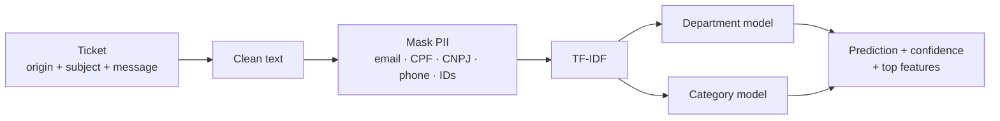

# Ticket Classifier

Routes support tickets automatically. For each ticket it predicts the **department** and the **category**
with a confidence score, and it masks personal data **before** any text reaches the model.

<p><a href="README.pt-BR.md">🇧🇷 Documentação completa em português</a></p>

> The dataset in `data/` is **synthetic** (invented tickets) and is included so you can train and test the
> project end to end.

## Why

Tickets arrive by email, web panel and API with free text. Manual triage is slow and inconsistent.
This project is a deliberately simple, explainable baseline: TF-IDF features with Logistic Regression.
It trains in seconds, runs on a CPU and is easy to audit. Use it before reaching for an LLM, or as a
cheap first pass in front of one.

## Pipeline



## Highlights

- **Two predictions per ticket** (department and category), each with its own confidence score.
- **PII masking before training and inference.** E-mails, CPF, CNPJ, phone numbers and long IDs become
  tokens such as `[EMAIL]` and `[CPF]`. Optional spaCy NER removes person names.
- **Explainability:** shows the features that drove each prediction.
- **Three interfaces:** Python API, interactive CLI and batch CSV/Excel processing.
- **Configurable** column mapping, model parameters and quality filters in `config.py`.
- **44 pytest tests**, run in CI.

## Quick start

```bash
pip install -r requirements.txt
python main.py                          # train on data/
python predict.py --origem Email --assunto "Login" --mensagem "Can't access the system"
python predict.py --file tickets.csv --output results.csv
pytest -q
```

```python
from classifier import classificador_mensagem
classificador_mensagem("Email", "Erro de acesso", "Não consigo fazer login no sistema")
# {'departamento': {'predicao': 'TI', 'confianca': 0.9}, 'categoria': {...}, 'sucesso': True}
```

## Stack

Python · scikit-learn · pandas · joblib · spaCy (optional) · pytest

## License

MIT
